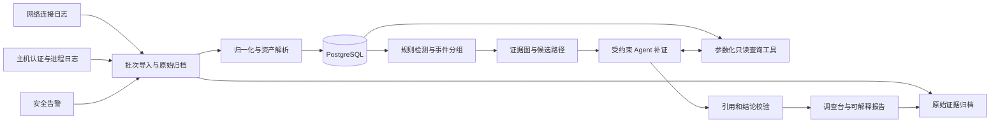

# 项目总体规划

## 1. 项目定位

项目名称：基于网络遥测与 AI Agent 的网络攻击溯源系统。竞赛展示简称可用“网络攻击证据溯源平台”，暂不固定品牌。

用户已确认：**4 人，3 周，竞赛展示**。以下实施方案由此倒排；不把原先讨论的16周假设继续带入。按每周5个工作日、每天每人约6小时可投入计算，共360人时；任务包约232人时，共同联调/实验/彩排约98人时，机动30人时。D1–D10每人任务50小时、联调10小时，D11–D15集中验证与交付；这是紧凑排期，超时应立即减范围。实际投入不足时按降级顺序缩减功能，不能减少证据真实性约束。

目标用户是竞赛评委和进行事件调查的安全分析人员。系统回答：发生了什么、涉及哪些资产、入口候选是什么、路径如何形成、每个结论依据何在、还有什么不知道。输出不是一段泛泛的大模型总结，而是可以从结论点回原始日志的调查结果。

## 2. 可验证的价值

| 痛点 | 实现 | 展示证据 |
|---|---|---|
| 网络、主机、告警信息分散 | 三类数据归一化，统一时间与身份 | 点一个事件查看多源关联 |
| 告警之间缺少上下文 | 规则关联与带证据的事件图 | 时间线、路径和关联理由 |
| 模型可能编造结论 | 只读工具、结构化输出、逐项引用验证 | 工具轨迹、被拒绝的不实结论样例 |
| 分析结果难以复核 | 原始片段、哈希、版本和报告快照 | 一键展开证据和下载报告 |
| 数据不完整时过度归因 | 输出缺口与竞争性解释 | 删除主机日志后主动降低结论强度 |

创新假设：证据约束与补证循环可以提高报告的可验证性；网络与主机协同可以改善路径关联；可恢复的调查轨迹可以提高展示中的可解释性。**这些是待验证假设，不预先宣称首创、显著提升或达到某百分比。**

## 3. 三种路线比较与本方案选择

| 路线 | 优点 | 三周风险 | 结论 |
|---|---|---|---|
| 纯规则/查询看板 | 可控、易验收 | AI 仅成为装饰，补证能力弱 | 保留为基线和降级路径 |
| 大模型直接阅读全量日志 | 快速出现自然语言结果 | 上下文溢出、引用错误、不可复现 | 不采用 |
| 规则 + 证据图 + 有界 Agent | 分析结果可核验，职责明确 | 需先冻结数据契约 | **推荐并按此形成完整设计草案** |

这里的技术选择是规划建议，不代表用户已确认某个库、模型或云服务。当前请求只产出方案，不自动启动应用开发或购买资源。

## 4. 功能范围与裁剪

### P0：必须交付

- 三类日志文件导入：Zeek `conn`/可选 `dns`、Linux 结构化 audit/auth 日志、Suricata EVE 告警；现场不依赖抓取真实公网流量。
- 统一事件、原始证据索引、批次清单、时间质量、资产 IP 有效区间。
- 6 类可解释规则，包括扫描、认证失败后成功、异常父子进程、跨主机会话关联、周期连接、异常出站量；精确条件见规则文档。
- 事件分组、证据图、候选入口、路径列表与关系强弱区分。
- 受控 Agent：自主选择下一项允许的只读工具查询；至少完成一次“发现缺口→查询补证→修订结论”；不是固定报告换皮。
- 调查报告：观察事实、假设、引用、未知项、替代解释、影响范围、建议人工检查项。
- 四个界面：概览/导入、事件队列、调查详情、报告与运行记录。
- 3 条演示线：完整多阶段事件、周期连接异常、正常运维/缺证反例。
- 可复现评估、断网模式、干净环境部署说明、8 分钟演示与答辩素材。

### P1：有余力才做

- 实际网络镜像口采集、Sysmon Windows 接入、DNS 辅助关联。
- 应用内 WebSocket 进度、图谱布局保存、额外数据格式。
- 轻量 Isolation Forest 与现有规则对比。没有完整标签与时间划分就不做。
- PDF 报告。P0 只提供 JSON 和自包含 HTML，避免文档渲染占用时间。

### P2：赛后扩展

- Neo4j 图存储、ClickHouse 分析存储、消息队列、分布式任务与多租户。
- eBPF、NetFlow/IPFIX、云审计、EDR 等更广泛遥测。
- 跨组织调查、长期威胁狩猎、模型微调、复杂图学习、生产高可用。
- 资产隔离、封禁、远程取证等响应动作需另立权限与审批设计，不进入三周原型。

## 5. 选择的技术栈

| 层 | 三周选择 | 选择原因与约束 |
|---|---|---|
| 开发/部署 | Windows 开发 + Linux 虚拟机/WSL2；Linux Docker Compose 部署 | 传感器离线处理优先 Linux；现场可直接用预生成日志 |
| 后端 | Python 3.12、FastAPI、Pydantic、SQLAlchemy、Alembic | 同一语言实现解析、规则、图和 Agent，减少跨语言成本 |
| 数据库 | PostgreSQL 16 基线 | 统一业务状态、JSONB 事件、任务队列和图的事实表 |
| 图算法 | NetworkX，按事件构建有界子图 | 不额外部署图数据库；超限分页/裁剪，不能全库装内存 |
| Agent | 明确状态机 + 模型适配器 + PostgreSQL 检查点 | 三周内便于追踪和调试；LangGraph 仅为赛后可替换实现 |
| 前端 | React、TypeScript、Vite、Cytoscape.js | 单页调查台；功能以契约为准，不追求复杂动画 |
| 证据存储 | 本地只读归档目录 + 数据库清单 | 原始证据和工作区分离；对象存储后续适配 |
| 部署 | web、api、worker、db 四服务 | 不引入 Kafka、Redis、Kubernetes |
| 测试 | pytest、HTTP 契约测试、Playwright 关键流程 | 覆盖幂等、证据引用、权限和恢复优先 |

上表是版本基线与选型建议，不是已验证的兼容性结论。D1 必须在目标机器完成安装验证、锁定全部精确依赖和镜像摘要；不使用浮动 `latest`。模型不绑定厂商，先验证兼容接口、中文、工具选择和 JSON 输出，再写入版本清单。无 GPU 时可使用获准的远程模型处理脱敏实验数据；离线确定性分析仍可运行。

## 6. 架构概览

图数据库是存储手段，知识图谱是数据建模方式。本项目用关系表保存实体、证据边和知识映射，仍可形成并查询图结构，不必为了名称增加运维组件。

## 7. 团队分工

| 角色 | 主责 | 交叉复核 | 每天最重要的产物 |
|---|---|---|---|
| A：组长/后端/部署 | 契约、API、数据库、作业、打包 | C 复核权限与状态 | 可运行集成版本 |
| B：遥测/检测/数据 | 解析器、场景采集、规则、真值与划分 | A 复核幂等；D 复核标签 | 可重放样例和规则测试 |
| C：图谱/Agent | 实体关联、路径、工具、输出校验 | B 复核证据；A 复核接口 | 带证据的调查结果 |
| D：前端/测试/展示 | 界面、端到端验证、演示与材料 | C 复核界面语义 | 一条可操作用户流程 |

每日 15 分钟站会：昨天交付证据、今天唯一关键产物、阻塞与需要接口。每天结束合入可运行版本，不保留一周不联调的分支。D 同时承担集成测试，因此前端只做四页。

## 8. 阶段门禁

| 时间 | 里程碑 | 必须展示的证据 | 未通过的处理 |
|---|---|---|---|
| D1 | 范围与契约冻结 | 版本清单、样例、字段表、任务板 | 缩减格式，不增加功能 |
| D3 | 最小闭环 | 上传一批数据→一条告警→一条图边→有引用报告→页面可看 | 停止所有 P1，集中联调 |
| D5 | 数据与检测最小版 | 三类样例接入、2类规则、最小路径、同对象重复导入不增计数；完整解析异常覆盖后补 | 先收紧支持格式，不增加额外来源 |
| D8 | 核心溯源可用 | 6类规则冻结、入口候选、路径、补证、关键反例拒答 | 固定图规模，减少查询种类 |
| D10 | 功能冻结 | 三演示线、权限、超时降级、离线报告 | 后续只修阻断缺陷 |
| D12 | 评估完成 | 锁定数据集结果、失败样例、资源曲线 | 如不达标，诚实缩小结论适用范围 |
| D14 | 发布候选 | 干净部署、两次计时彩排、离线备份 | 启动备机/预计算结果路径 |
| D15 | 交付 | 发布包、源代码、复现材料、视频、答辩分工 | 记录未达项，不追加风险功能 |

## 9. 目标与能力声明

目标硬件假设：8 逻辑核、16 GB RAM、至少 40 GB 可用 SSD；无需独立 GPU。目标数据量 10 万规范化事件，单次调查子图最多 500 节点/1000 边，界面初始显示 100 节点。实际设备未知，D1 校准。初始目标：固定回放 50 EPS 持续 30 分钟；普通列表查询 p95 ≤ 2 秒；单调查总超时 90 秒，其中模型交互预算 60 秒。指标口径和失败处理见评估文档。

三周只能证明受控场景可行性。不要宣称企业级海量吞吐、未知威胁通用检测、APT 组织归因、生产可用或自动取代专家。加密流量只基于可见元数据分析，不声称还原未采集内容。

## 10. 最终交付与赛后路线

交付源代码、锁文件、迁移、配置模板、镜像清单、运行脚本、脱敏数据和哈希、真值与划分清单、指标脚本和原始结果、3 个场景、报告样例、用户手册、演示视频、答辩 PPT 素材和限制清单。演示使用的数据与评估测试集分开。

赛后按依赖扩展：先扩大独立场景和数据质量验证，再做实时采集及 Windows 支持，再以性能瓶颈决定是否引入图数据库和队列，最后考虑异常模型、论文实验和组织内试点。未经真实试点验证不把竞赛原型直接接入生产网络。
