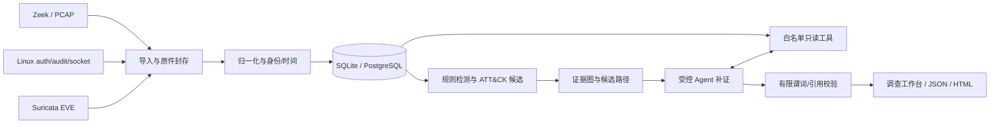

# 网络遥测与 AI Agent 攻击溯源

[](https://github.com/WJH060717/-AI-Agent-/actions/workflows/ci.yml)

面向授权实验环境的防御性调查原型：把网络连接、主机认证/审计、安全告警和离线抓包整理成可回查的证据，生成检测候选、资产/传播路径和带引用、带未知项的调查报告。

**源码版本** `0.1.0.dev44` · **数据库迁移** `0006_d9` · **默认模型** `disabled`

[六阶段展示页](docs/d13-showcase.html) · [本地工程演示](docs/d14-showcase.html)

## 解决的问题

| 痛点 | 本项目怎么做 | 可核验证据 |
| --- | --- | --- |
| 网络、主机、告警、抓包彼此割裂 | 同一工作区/数据集/会话/时间窗内按可信资产映射选入快照，保留全部规则种子 | `snapshot_selection@1.0.0` 清单、来源/类型/选取原因计数 |
| 告警之间缺少上下文 | 规则检测 + 有证据的事件图 + 候选路径/断点 | 逐边 `evidence_refs`、方法版本、限制 |
| 模型可能编造结论 | 只读白名单工具、结构化输出、逐项引用/范围校验 | 工具轨迹、被拒绝结论、`claim_validation` |
| 不知道哪个进程发起了外联 | 可选 `linux_socket` 采集，强进程身份 + 五元组 + 时间窗绑定 | `opened` 边、两侧原始证据；缺证仍保留断点 |
| 数据不完整时过度归因 | 明确输出 `partial`、断点、未知和正常替代解释 | 覆盖限制、停止原因、历史报告不重算 |

## 系统架构



规则与迁移保持冻结版本；新能力通过新增契约、版本化清单和独立候选实现，不回写旧报告或原始证据。

## 当前能力

| 能力 | 状态 | 入口/验收 |
| --- | --- | --- |
| Zeek、Suricata、Linux auth/audit、PCAP 包观测、Linux socket JSONL 导入 | 已实现（合成夹具） | `packages/ingest/`、`data/fixtures/` |
| R01–R30 规则与冻结配置；R31 纯失败认证猜测 | 已实现（开发回归） | `packages/detection/`、`rules/` |
| 跨源调查快照：全部种子 + 可信资产上下文，超限显式 partial/错误 | 已实现 | `packages/storage/analysis.py`、`tests/integration/test_snapshot_selection.py` |
| 进程—连接 socket 绑定与断点 | 已实现（需显式强身份 socket 记录） | `packages/graph/service.py`、`tests/contract/test_socket_binding.py` |
| Agent 逐类策略：扫描、DNS 答复冲突、ARP 映射冲突 | 已实现（有限判断器） | `packages/agent/strategies.py`、`tests/contract/test_agent_strategies.py` |
| DNS 请求/应答、ARP 声明冲突、TCP SYN 扫描的包级图投影 | 已实现（有界启发式） | `packages/graph/service.py` |
| 版本化 ATT&CK manifest 与显式未映射规则 | 已实现 | `knowledge/attack-18.1/manifest.json` |
| 六阶段执行状态、补证前后对比、证据抽屉、20/50/100 节点图 | 已实现 | `apps/web/src/Investigation.tsx`、`PipelineProgress.tsx` |
| 公开测试/私有材料分组 | 已实现（缺料明确 skip） | `tests/conftest.py`、`.github/workflows/ci.yml` |
| 独立 B0–B3 正式对比、真实模型验收、干净机器验收 | 未完成 | 见 `eval/current-ledger.json`、`docs/verification-dev44.md` |

## 五分钟启动（Windows PowerShell）

需要 Python 3.12、Node.js 22+。不需要 PostgreSQL，默认 SQLite、模型关闭。

```powershell
git clone https://github.com/WJH060717/-AI-Agent-.git AI-Agent
cd AI-Agent
python -m venv .venv
.\.venv\Scripts\python.exe -m pip install -r requirements-dev.lock
```

在仓库外准备一个**新目录**的演示库；脚本拒绝覆盖已有目录，且只导入公开合成夹具：

```powershell
.\.venv\Scripts\python.exe -m scripts.demo_prepare --root ..\trace-demo
```

终端会输出只显示一次的 `viewer/analyst/admin` 令牌，以及 `workspace_id`、`dataset_id`。随后启动后端与 worker（两个窗口）：

```powershell
$env:DATABASE_URL = "sqlite:///..\trace-demo\demo.db"
$env:RAW_STORE = "..\trace-demo\raw"
$env:STAGING_STORE = "..\trace-demo\staging"
$env:MODEL_PROVIDER = "disabled"
.\.venv\Scripts\python.exe -m apps.api.main
```

```powershell
$env:DATABASE_URL = "sqlite:///..\trace-demo\demo.db"
$env:RAW_STORE = "..\trace-demo\raw"
$env:STAGING_STORE = "..\trace-demo\staging"
$env:MODEL_PROVIDER = "disabled"
.\.venv\Scripts\python.exe -m apps.worker
```

前端（第三个窗口）：

```powershell
cd apps\web
npm ci
npm run dev
```

打开 `http://127.0.0.1:5173/`，用 `admin` 令牌连接；演示数据集已经包含 D1 合成事件。也可以按 `zeek`、`linux_auth`、`linux_audit`、`suricata` 来源导入 `data/fixtures/d1/` 对应 JSONL。

## 样例流程

1. 连接工作区，选择演示数据集。
2. 在“待核查异常”选择候选，点击“开始调查”；默认“仅规则”不调用模型。
3. 在“结论”查看报告、引用和未知项；在“关系与时间线”点击图节点/边查看判据与证据。
4. 在“补证对比”查看真实工具返回前后的证据差集；没有新增时不会伪造判断改善。
5. 导出 JSON/HTML；历史报告按原快照读取，不重算。

## 实测结果（本版本）

- 公开合成检测规模：1,000 / 10,000 / 100,000 事件分别为 **0.10s / 0.73s / 9.82s**，峰值约 0.24 / 2.08 / 23.46 MB；只证明检测阶段容量，不等同十万条端到端溯源。见 `docs/capacity-dev44.json`。
- 调查快照默认/最大 **250** 事件，扫描候选上限 **20,000**；二者与检测上限分开报告。
- 工程回归与前端检查的实际结果见 `docs/verification-dev44.md`。
- 历史行为集 **2/16**、独立 DoS/DDoS v2 **11/12** 和工程回归属于不同口径，不能相加为总体准确率；历史结果按原版本保存。

## 限制

- 没有独立的授权多源活动链、双人标注和正式 B0–B3 对比；当前不能公布检测准确率或 Agent 增益。
- 没有真实模型调用授权；默认 `MODEL_PROVIDER=disabled`，协议桩只证明工程链路。
- socket 采集适配器要求显式强进程身份；没有记录时路径保留 `missing_socket_binding` 断点。
- DNS/ARP/扫描图投影是有界启发式，不证明缓存欺骗、中间人转发或攻击成功。
- 未在干净非作者机器、物理断网或现场 8 分钟彩排中验收。
- 项目整体许可尚未由权利人确认；见 `LICENSE-STATUS.md`、`THIRD_PARTY_NOTICES.md`。

## 文档导航

- [项目规划](PROJECT_PLAN.md)、[强制规约](PROJECT_SPEC.md)、[数据契约](docs/02-data-contracts.md)
- [检测与图](docs/03-detection-graph.md)、[Agent](docs/04-agent.md)、[API/UI](docs/05-api-ui.md)
- [dev44 验证](docs/verification-dev44.md)、[能力索引](docs/capabilities-dev44.json)、[实验台账](eval/current-ledger.json)
- [容量表](docs/capacity-dev44.md)、[独立实验方案](docs/experiments-dev44.md)
- [部署/演示](docs/08-deployment-demo.md)、[历史开发记录](docs/change-log.md)

## 许可

项目原创代码和文档当前为版权保留，未授予开源许可；最终许可待权利人确认。第三方依赖、MITRE ATT&CK 资料和合成数据的边界见 `THIRD_PARTY_NOTICES.md`。