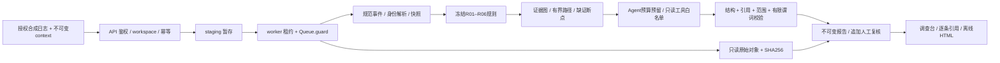

# 技术说明与答辩口径

## 架构与信任边界

实际存储为关系表和内存子图，后台队列也在库内。模型不能获取SQL、shell、文件路径权限或数据库口令；日志/检索内容不能变更权限。所有写入依租约与版本，模型调用前持久预留预算，中断不退款。没有Kafka、Neo4j、Kubernetes或训练模型。

## 已实现工程机制

- 从对象→物理片段→规范事件→图边→快照→报告引用可追溯；哈希不证明传感器诚实。
- 事件时间、主机/启动标记参与身份解析；IP/PID复用、时间冲突和缺socket保留不确定。
- Agent before保留规则种子；after只增实际工具返回；恢复保持预算、before和状态轨迹，不重写报告。
- 图边区分观察与推断；断点显式呈现；自由模型claim不能因引用存在就自动成为事实。
- 文本安全渲染，引用/工作区/快照隔离；复核仅追加，人工accepted不提升原结论事实级别。

这些是可展示的工程组合与约束，不声称论文新颖性、首创或优于全部SIEM。真实模型补证效果仍需正式对照实验；本轮录像默认模型禁用。

## 常见追问

| 问题 | 可核对回答 |
|---|---|
| AI到底做了什么？ | 设计允许模型在白名单内选择查询并结合实际新证据修订报告；协议桩已验证接口和恢复机制。真实LLM验收未完成；本轮展示规则/图与deterministic_fallback。 |
| 能找到黑客吗？ | 能呈现最早观测、入口与候选传播关系；现实身份和完整因果需要额外证据，未知保持未知。 |
| 如何防幻觉？ | 分层校验、引用范围、有限谓词、降级和人工复核降低风险，不能保证所有自由文本正确。passed仅指保留结论校验。 |
| 为什么有断点？ | 缺socket/出生标记/严格时序时不能补连；断点体现观测边界。 |
| 有多少真实数据？ | 当前33planned、0双复核；开发合成数据可运行，不能称真实攻击盲测。 |
| 指标如何解释？ | 展示D12可复算清单，含失败、零分母、未知账单；D11历史性能与当前展示版本分开。 |
| 是否生产可用？ | 4人3周原型、单工作区。单进程限流、图/检测上限、默认禁用模型；不是企业安全平台。 |
| 演示中live是真的吗？ | 看run.source_mode和停止原因。协议桩、cached、fallback、replay明确区分；预录永不说成现场AI。 |

D12底座已归档422 Python、123 PostgreSQL、6浏览器检查；这些是底座历史证据，不当作D13重跑的计数。D12恢复验证28表/32事件/旧报告并运行新调查；非作者恢复仍待签署。D11第三轮查询P95约83.1ms，也保留第二轮2759.55ms失败，检测超过10000仍partial，回放未测。
